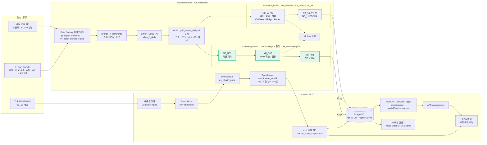
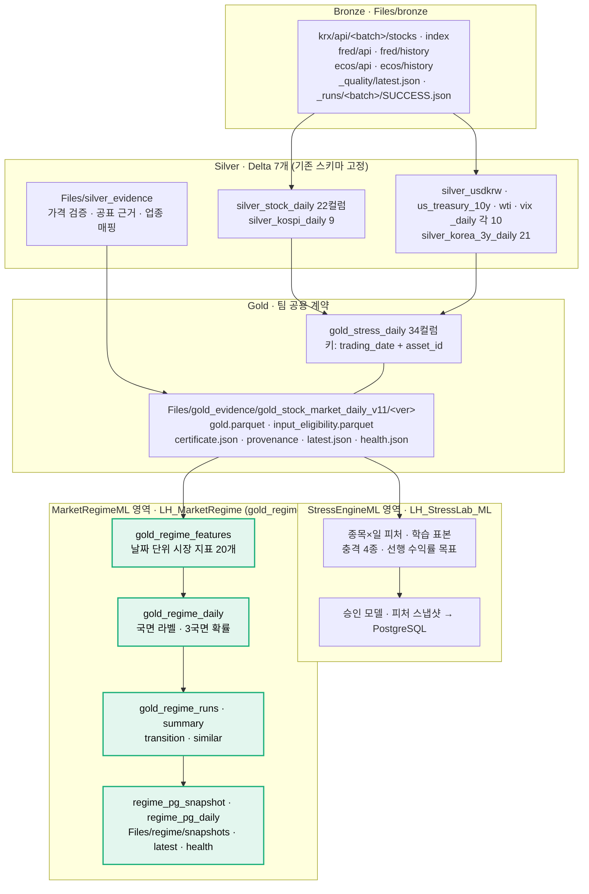
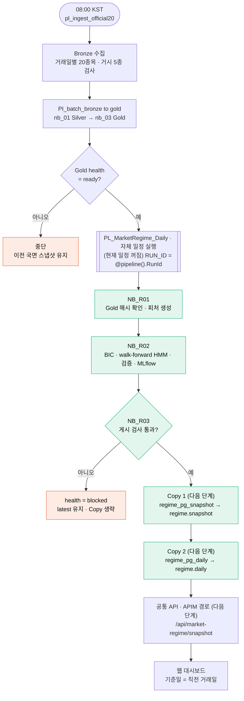
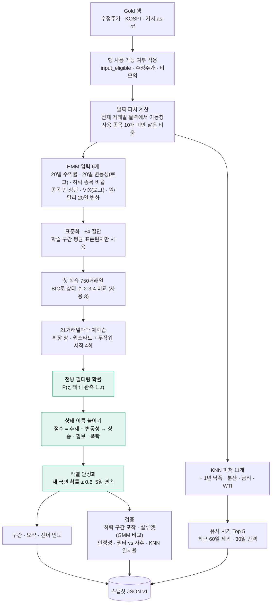

# Fabric 시장 국면 분석 ML 기획서 — 최종본

**WHAT IF · MarketRegimeML v1.0** · 작성 Yunil So · 2026-11-18
상태: 코드·화면·API 계약 확정(v1) / **2026-11-24 팀 워크스페이스(`ws-whatif-dev` › `MarketRegime`)에서 실제 Gold로 구축·실행 완료** / PostgreSQL·API·웹 메뉴 연결은 다음 단계

> 과거 데이터 기반 시장 분석이며 투자 권유·종목 추천·수익 보장이 아닙니다.

---

## 0. 한 장 요약

| 항목 | 내용 |
|---|---|
| 한 줄 정의 | 팀 Gold(`gold_stress_daily`)로 현재 시장이 **상승장·횡보장·폭락장** 중 어디인지 확률과 함께 진단하고, 국면 이력과 현재와 비슷했던 과거 시기를 보여 주는 시장 분석 ML |
| 담당 | Fabric 데이터사이언티스트 A — 시장 국면 분석(Market Regime Switching) |
| 핵심 모델 | 가우시안 HMM(국면 분류, walk-forward) + KNN(유사 시기 조회) · 보조: GMM(비교 실험) |
| 데이터 | 팀 메달리온 Gold 재사용(KRX 20종목·KOSPI·환율·미국 10년·WTI·VIX·국고 3년). 새 Bronze·Silver·Gold 없음 |
| 플랫폼 | Microsoft Fabric(Notebook·Lakehouse·Data Factory·MLflow) → PostgreSQL → FastAPI(Container Apps) → 웹앱 |
| 산출물 | 모듈 3종, Fabric 노트북 3개, PostgreSQL DDL, API 라우터, 웹 대시보드, 문서 6종(본 기획서 포함) (`WHATIF_MarketRegime_ML_v1.zip`) |
| 갱신 | 하루 1회, Gold 갱신 직후(기준일 = 직전 거래일) |
| 제외 범위 | 스트레스 테스트, 포트폴리오 손익, 자산 배분, 변동성 예측, 매매 제안, 이후 수익률 예측 |
| 남은 일 | 실제 Gold로 첫 실행 → 결과 검토·조정 → 파이프라인·API 배포 → 웹 연결 → 발표 수치 반영 |

---

## 1. 배경, 목적, 범위

금융시장은 상승장·횡보장·폭락장처럼 성격이 다른 국면을 오가고, 국면마다 수익률 분포와 종목 간 동조화 수준이 달라집니다. 이 프로젝트는 그 국면을 통계적으로 진단해 WHAT IF 서비스 이용자가 **지금 시장이 어떤 상태인지**를 이해하도록 돕습니다.

**목적**

1. 현재 시장 국면을 확률과 함께 진단한다.
2. 국면별 특성, 과거 전이 빈도, 지속 기간을 보여 준다.
3. 현재와 비슷했던 과거 시기를 조회해 비교할 수 있게 한다.

### 1.1 담당 범위

| 구분 | 내용 | 포함 여부 |
|---|---|---|
| 시장 국면 분석 | 현재 시장이 상승장·횡보장·폭락장 중 어디인지 판단 | 포함 (핵심) |
| 국면 전환 이력 | 과거 전이 빈도, 국면별 지속 기간, 구간 목록 | 포함 |
| 유사 과거 시기 조회 | 현재와 비슷했던 과거 날짜 (이후 수익률 없음) | 포함 (보조) |
| 리스크 예측·스트레스 테스트 | 충격 조건별 포트폴리오 타격 시뮬레이션 | 제외 (StressEngineML 담당) |
| 동적 자산 배분 | 국면별 전략·안전자산 전환 | 제외 |
| 변동성 예측 | 옵션 가격, 헤지 비율 | 제외 |
| 투자 자문 | 매수·매도·비중 제안, 종목 추천 | 제외 |

### 1.2 표현 원칙

- "예측"이 아니라 "현재 국면 진단"과 "과거 유사 시기 조회"라고 말합니다.
- 확률은 현재 상태에 대한 모델 추정치이고, 다음 국면을 예측하지 않습니다.
- 유사 시기는 날짜·거리·당시 국면만 보여 주고, 그 이후 수익률은 계산하지 않습니다.
- 모든 화면과 API 응답에 투자 권유 아님 문구를 넣습니다.
- 결과는 시장 전체 수준으로만 보여 주고, 개별 종목 판단은 내놓지 않습니다.

---

## 2. 업무 분석

### 2.1 담당 영역과 처리 흐름

| 단계 | 담당 영역 | 하는 일 | 기법 |
|---|---|---|---|
| 1 | 데이터 전처리(피처) | Gold에서 날짜 단위 시장 상태 지표 20개 생성(동조화·하락 확산·거시 변화 포함) | 이동창 통계, 종목 간 상관, as-of 거시 |
| 2 | 시장 상태 분류 | 보이지 않는 시장 상태를 3개 국면으로 분류하고 확률 산출 | HMM (GMM은 비교) |
| 3 | 유사 시기 조회 | 기준일과 가장 비슷했던 과거 날짜 탐색 | KNN (유클리디안) |
| 4 | 검증·게시 | 검증 지표 계산, 검사 통과 시 스냅샷 게시 | 게시 검사, 해시 인증 |

### 2.2 모델별 역할

| 모델 | 핵심 질문 | 이 프로젝트에서의 역할 | 시간 순서 반영 |
|---|---|---|---|
| HMM | 보이지 않는 시장 국면이 언제 바뀌었는가? | **핵심**: 국면 분류, 전이 빈도, 지속 기간 | 반영 |
| GMM | 현재 데이터는 어떤 장세일 확률이 높은가? | **보조**: HMM과 실루엣 비교 | 미반영 |
| KNN | 과거에 지금과 가장 비슷했던 날은 언제인가? | **보조**: 유사 시기 조회 | 미반영 |

---

## 3. 전체 기술 아키텍처 (Azure + Fabric)



초록색이 이 프로젝트(MarketRegimeML)이고, 보라색은 StressEngineML입니다. 두 ML은 Gold부터 갈라지고, PostgreSQL과 FastAPI에서 다시 만납니다.

| 계층 | 구성 요소 | 소유 | MarketRegimeML의 사용 방식 |
|---|---|---|---|
| 수집 | `nb_ingest_official20`, `pl_ingest_official20` (KRX·FRED·ECOS, 08:00 KST) | 데이터 담당 | 그대로 사용 |
| 정제 | `nb_01_Bronze_to_Silver`, `nb_03_Gold_Build`, `PI_batch_bronze to gold` | 데이터 담당 | 그대로 사용 (수정 없음) |
| Gold 계약 | `gold_stress_daily` 34컬럼 + 인증 스냅샷 + `input_eligibility` | 팀 공용 | **유일한 입력** |
| ML | `MarketRegime/NB_R01~R03`, `Files/reference/market_regime/v1` | **본인** | 신규 |
| 실험 관리 | MLflow 실험 `MarketRegime_HMM` | **본인** | 신규 |
| 서빙 DB | Azure PostgreSQL `regime` 스키마 | 본인 + DB 권한자 | 신규 스키마 |
| API | FastAPI 라우터 `/api/v1/market-regime/*` | 본인 작성, 백엔드 배포 | 기존 앱에 추가(권장) |
| 웹 | `regime-dashboard.js/.css` (의존성 없는 JS 모듈) | 본인 작성, 프론트 연결 | 메뉴로 추가 |
| 실시간 | 키움 → Event Hubs → Eventstream → Eventhouse → KQL → 시장 상태 API | 실시간 담당 | **사용하지 않음** (10절) |
| 보안·운영 | Key Vault, Entra External ID, Monitor, API Management | 팀 공용 | DSN은 Key Vault 참조 |

---

## 4. 메달리온 아키텍처와 스키마



### 4.1 공용 계층 (팀이 운영 중, 수정하지 않음)

| 계층 | 저장 위치 | 주요 내용 | 품질 장치 |
|---|---|---|---|
| Bronze | `Files/bronze/` | KRX `sto/stk_bydd_trd`·`idx/kospi_dd_trd`, FRED `DEXKOUS`·`DGS10`·`DCOILWTICO`·`VIXCLS`, ECOS `817Y002/010200000` 원본 JSON, 과거 이력 파일 | 거래일별 20종목·지수 완전성, 거시 지연 한도, 실행별 원본 보존, `_quality/latest.json` |
| Silver | Delta 7개 | `silver_stock_daily`(22), `silver_kospi_daily`(9), `silver_usdkrw/us_treasury_10y/wti/vix_daily`(각 10), `silver_korea_3y_daily`(21) | 기존 정상 수치 보존·NULL만 보완, 수정주가 검증, 공표 근거, WTI 원본 대조 |
| Gold | Delta `gold_stress_daily` + `Files/gold_evidence/gold_stock_market_daily_v11/<ver>/` | 34컬럼(키 `trading_date`+`asset_id`), 거시 as-of 선택값과 관측일·공표 근거 | sha256 인증서, `input_eligibility`, `health.json`(ready/blocked), Delta와 스냅샷 일치 검사 |

**Gold 34컬럼 중 MarketRegimeML이 읽는 13개**: `trading_date`, `asset_id`, `close`, `volume`, `price_basis`, `quality_status`, `is_mock`, `kospi_close`, `usdkrw`, `us_treasury_10y`, `wti`, `vix`, `korea_3y` + 인증 파일 `input_eligibility.parquet`(`input_eligible`).

### 4.2 MarketRegimeML 계층 (신규, 별도 Lakehouse `LH_MarketRegime`에 `gold_regime_*`로 저장. 팀 `lh_whatif`는 바로가기로 읽기만 함)

Gold 위에 쌓는 파생 분석 계층입니다. 스트레스엔진의 `LH_StressLab_ML`과 섞이지 않게 이름과 폴더를 나눴습니다.

| 테이블/파일 | 키 | 주요 컬럼 | 생성 |
|---|---|---|---|
| `gold_regime_features` | `trading_date` | `kospi_close`, `n_assets`, `date_ok`, 시장 지표 20개(6.2절) | NB_R01 |
| `gold_regime_daily` | `trading_date` | `p_bull`, `p_sideways`, `p_bear`, `raw_code`, `regime_code`, `regime_name`, `label_basis`, `run_id`, `run_day`, `kospi_close` | NB_R02 |
| `gold_regime_runs` | `run_id` | `regime_code`, `start`, `end`, `days`, `kospi_change_pct`, `label_basis`, `is_current` | NB_R03 |
| `gold_regime_summary` | `regime_code` | `day_share`, `n_runs`, `avg/median/max_run_days`, `ann_return_pct`, `ann_vol_pct`, `avg_corr_60d`, `avg_vix` | NB_R03 |
| `gold_regime_transition` | `from_code`+`to_code` | `daily_count`, `daily_frequency`, `run_transition_count` | NB_R03 |
| `gold_regime_similar` | `snapshot_version`+`rank` | `similar_date`, `distance`, 당시 국면, `z_<피처>` | NB_R03 |
| `regime_pg_snapshot` / `regime_pg_daily` | `snapshot_version` | PostgreSQL 복사용 단계 테이블(이번 실행분만) | NB_R03 |
| `Files/regime/snapshots/<ver>/` | – | `regime_snapshot.json` + `certificate.json`(sha256) | NB_R03 |
| `Files/regime/latest.json`, `health.json` | – | 최신 포인터, ready/blocked | NB_R03 |
| `Files/regime/runs/<RUN_ID>/` | – | `context`·`model`·`bic`·`validation` json | NB_R01~R03 |

### 4.3 서빙 계층 (PostgreSQL)

| 테이블 | 키 | 내용 |
|---|---|---|
| `regime.snapshot` | `snapshot_version` | `as_of`, `model_version`, `data_mode`, `gold_snapshot_version`, `payload_text`(스냅샷 JSON 원문), `payload_sha256`, `created_at` |
| `regime.daily` | `snapshot_version`+`trading_date` | 일별 국면·확률 (SQL·BI 조회용) |
| `regime.v_latest_snapshot` | – | `data_mode='fabric_gold'` 중 최신 1행 |

API는 `regime.snapshot` 최신 행만 읽고 sha256을 대조합니다. 스냅샷 JSON 구조(schema_version 1)는 `03_API_계약서.md` 2절에 있습니다.

---

## 5. 파이프라인 구성도



### 5.1 노트북별 입출력

| 노트북 | 입력 | 처리 | 출력 | 실패 시 |
|---|---|---|---|---|
| NB_R01 피처 | Gold health·latest·certificate, `gold.parquet`, `input_eligibility.parquet` | 모듈 해시 확인 → Gold 해시 확인 → 피처 생성 → 최신일·이력 길이 검사 | `gold_regime_features`, `context.json`, `current_run.json` | `GOLD_NOT_READY`, `*_HASH_MISMATCH`, `HISTORY_TOO_SHORT` |
| NB_R02 학습·검증 | `gold_regime_features`, `context.json` | BIC → walk-forward HMM → 라벨 안정화 → 검증 → 그림 → MLflow | `gold_regime_daily`, `model`·`bic`·`validation.json` | 확률 합 오류, 실시간 판정 252일 미만 |
| NB_R03 게시 | 위 테이블·json | 구간·요약·전이·유사 시기 → 스냅샷 → 게시 검사 → 파일·테이블·포인터 | 4.2절 테이블, 스냅샷, `latest.json`, `health.json` | `health=blocked`, 이전 latest 유지 |

### 5.2 파이프라인 `PL_MarketRegime_Daily`

| 순서 | 활동 | 매개변수·설정 |
|---|---|---|
| 1 | Notebook NB_R01 | `RUN_ID=@pipeline().RunId` |
| 2 | Notebook NB_R02 | `RUN_ID`, `LOG_TO_MLFLOW=true` |
| 3 | Notebook NB_R03 | `RUN_ID`, `DATA_MODE=fabric_gold` |
| 4 | Copy | `regime_pg_snapshot` → `regime.snapshot` (삽입) |
| 5 | Copy | `regime_pg_daily` → `regime.daily` (삽입, 4 다음) |

실행 시점은 팀 Gold 갱신 뒤입니다. 팀 파이프라인을 수정하지 않기 위해 `PL_MarketRegime_Daily`의 자체 일정(매일 10:30 KST, 현재 꺼짐)으로 실행합니다. 각 활동은 앞 활동이 성공했을 때만 이어집니다. 2026-11-24 현재 1~3번 노트북 활동만 구축되어 있고, 4·5번 복사 활동은 PostgreSQL 준비 뒤에 추가합니다.

### 5.3 일정 흐름 (평일 기준)

| 시각(KST) | 일 | 결과 |
|---|---|---|
| 08:00 | Bronze 수집(전 거래일분) | `_quality/latest.json` |
| 08:00~ | Silver → Gold | `gold_stress_daily`, Gold health ready |
| 10:30 (일정 켠 뒤) | NB_R01~R03 (Fabric 실측 약 8분) | 국면 스냅샷, Power BI 즉시 반영 |
| 직후 (다음 단계) | Copy → PostgreSQL | API·웹에 새 기준일 반영 (API 캐시 5분) |

---

## 6. 알고리즘 기획서



### 6.1 입력 정제 규칙

- 행 사용 가능 = `input_eligible`(Gold 인증) ∧ `price_basis='adjusted'` ∧ 종가 > 0 ∧ `is_mock=false`. 인증 스냅샷이 없으면 `quality_status='valid'`를 씁니다.
- 수익률·이동창은 **전체 거래일 달력**에서 계산한 뒤 사용 가능 여부를 적용합니다(Gold 인증서의 `required_consumer_order`와 같은 방식).
- 하루 사용 종목이 10개 미만이면 그날 피처를 비웁니다. 거시 지표는 Gold가 이미 as-of로 고른 값(관측일 1~7일 전)을 그대로 씁니다.

### 6.2 피처 정의

| ID | 정의 | 단위 | HMM | KNN | 화면 |
|---|---|---|---|---|---|
| `kospi_ret_20d` | ln(KOSPIₜ / KOSPIₜ₋₂₀) | % | ● | ● | ● |
| `kospi_vol_20d(_log)` | 일간 로그수익률 20일 표준편차 × √252 (HMM은 로그값) | % | ● | ● | ● |
| `kospi_dd_252d` | ln(KOSPIₜ / 252일 최고치) | % |  | ● | ● |
| `breadth_down_5d` | 하락 종목 비율의 5일 평균 | % | ● | ● | ● |
| `avg_corr_60d` | 20종목 일간 수익률의 60일 평균 쌍별 상관 | corr | ● | ● | ● |
| `dispersion_20d` | 종목 간 수익률 표준편차의 20일 평균 | % |  | ● |  |
| `volume_z_60d` | 종목별 로그 거래량 60일 z-점수의 평균 | z |  |  |  |
| `vix_log` / `vix` | VIX 수준(로그) | pt | ● | ● | ● |
| `usdkrw_chg_20d` | ln(원/달러ₜ / 원/달러ₜ₋₂₀) | % | ● | ● | ● |
| `us10y_chg_20d` | 미국 10년 금리 20일 변화 × 100 | bp |  | ● | ● |
| `kr3y_chg_20d` | 국고 3년 금리 20일 변화 × 100 (선택 항목) | bp |  | ● | ● |
| `wti_chg_20d` | WTI 20일 변화율, ±60% 절단(2020-04-20 음수 가격 대비) | % |  | ● |  |
| 기타 | `kospi_ret_1d`, `vix_chg_5d`, 금리·환율·유가 수준, `n_assets` | – |  |  | 일부 |

HMM 입력은 6개, KNN 입력은 11개입니다. 1년 낙폭은 HMM에서 뺐습니다(6.9절 D-3).

### 6.3 국면 분류 모델 (HMM)

| 항목 | 설정 |
|---|---|
| 방출 분포 | 가우시안, 대각 공분산. 결측은 피처 단위로 제외(전부 결측이면 전이만 진행) |
| 학습 | Baum-Welch(EM), 최대 150회, 상대 수렴 1e-4, 분산 하한 1e-3 |
| 지속성 사전분포 | 전이 행렬 대각에 Dirichlet 의사 관측 10 (국면이 수주간 유지되는 성질 반영) |
| 초기값 | k-means++ 방식 무작위 시작 4회 + 직전 모델 웜스타트, 최대 로그우도 선택 |
| 입력 표준화 | 학습 구간 평균·표준편차만 사용, ±4로 절단 |
| 상태 수 | 3 (BIC로 2·3·4 비교 후 해석 가능성 때문에 3 고정, BIC 결과는 함께 보고) |
| 구현 | numpy 직접 구현(`hmm_numpy.py`). Fabric 파이프라인에서 `%pip` 설치 없이 실행 |

```
BIC = −2·logL + p·ln(n),   p = (K−1) + K(K−1) + 2·K·d     (K 상태 수, d 피처 수)
필터링 확률: αₜ(k) = P(sₜ = k | x₁..xₜ)  — 그날까지의 관측만 사용
```

### 6.4 Walk-forward (미래 정보 차단)

| 단계 | 내용 |
|---|---|
| 첫 학습 | 첫 완전 피처일부터 750거래일(약 3년). 이 구간 라벨은 `initial_in_sample`로 표시하고 검증에서 제외 |
| 재학습 | 이후 21거래일마다, 그 시점 **이전** 자료 전체로 다시 학습(확장 창) |
| 적용 | 각 블록의 날짜 t는 직전 모델로 1..t까지만 전방 필터링한 확률을 사용 |
| 보장 | 미래 행을 바꿔도 과거 확률이 변하지 않음을 테스트로 확인 |

### 6.5 국면 이름 붙이기와 라벨 안정화

- **이름**: 상태별 평균(표준화)에서 점수 = 20일 수익률 − 20일 변동성(로그)을 계산해, 높은 순서로 상승장·횡보장·폭락장을 붙입니다. 상태가 2개면 상승·폭락, 4개면 가운데 둘을 횡보장으로 묶습니다. 화면과 API는 항상 3개 국면입니다.
- **안정화**: 새 국면의 확률이 0.6 이상인 날이 5일 연속일 때만 공개 라벨을 바꿉니다. 그 사이는 `pending_switch`("전환 확인 중 n/5일")로 표시합니다.
- **구간**: 같은 라벨이 이어진 기간을 하나의 구간(run)으로 묶어 지속 일수와 구간 동안의 KOSPI 실제 변화를 기록합니다.

### 6.6 유사 시기 (KNN)

| 항목 | 설정 |
|---|---|
| 거리 | 기준일까지의 자료로 표준화한 KNN 피처 11개의 유클리디안 거리 |
| 후보 | 기준일 전후 60일 제외, 이웃끼리 30일 이상 간격, 상위 5개 |
| 결측 | 기준일에 값이 없는 피처는 빼고 계산(최소 5개), `features_dropped`에 기록 |
| 출력 | 날짜, 거리, 당시 국면, 그 국면 지속 일수, 피처별 z 값. **이후 수익률 없음** |

### 6.7 GMM 비교 실험

실시간 판정 구간의 같은 피처로 GMM(대각, 3성분)을 학습해, HMM 라벨과 GMM 라벨의 실루엣 점수를 비교합니다. 실루엣은 시간 순서를 보지 않아 GMM에 유리하므로 보조 근거로만 씁니다.

### 6.8 주요 파라미터

| 파라미터 | 값 | 바꾸는 곳 |
|---|---|---|
| `n_states` / `bic_candidates` | 3 / [2,3,4] | NB_R01 `CONFIG_OVERRIDES_JSON` |
| `min_train_days` / `refit_every` | 750 / 21 | 같음 |
| `n_init` / `transmat_prior` / `hmm_max_iter` / `z_clip` | 4 / 10 / 150 / 4 | 같음 |
| `label_threshold` / `label_confirm_days` | 0.6 / 5 | 같음 |
| `min_assets` | 10 | 같음 |
| `knn_k` / `knn_min_gap_days` / `knn_exclude_recent_days` | 5 / 30 / 60 | 같음 |
| `events` | 코로나19 급락(2020-02-20~03-31), 2022 금리 인상기(2022-06-01~10-31), 2024년 8월 급락(08-01~08-09), 2025년 4월 관세 충격(04-02~04-11) | 같음 |

### 6.9 설계 결정 기록

| # | 결정 | 근거 |
|---|---|---|
| D-1 | 새 Bronze·Silver·Gold를 만들지 않고 팀 Gold를 재사용 | KRX 공식 수정주가·거시 as-of·인증이 이미 있음. 키움 틱 집계는 날짜 추정·연결 끊김 복원 불가로 10년 학습에 부적합 |
| D-2 | KOSPI로 방향·변동성, 20종목으로 내부 구조(상관·하락 확산) | 20종목에 삼성전자 보통·우선주가 같이 있어 시장 방향은 지수가 더 정확 |
| D-3 | 1년 낙폭을 HMM 입력에서 제외 | 넣었을 때 반등기까지 폭락장으로 붙잡음(합성 테스트 폭락장 비중 45% → 제외 후 22%, 일치율 33% → 61%) |
| D-4 | 표준화 값 ±4 절단 | 처음 보는 극단값이 분산이 가장 큰 상태로 몰리는 현상 방지 |
| D-5 | 상태 수 3 고정 | 사용자 설명과 화면 일관성. BIC 결과는 함께 공개 |
| D-6 | numpy HMM 직접 구현 | 파이프라인 실행에서 설치 의존성 제거, 결측 처리 직접 제어 |
| D-7 | Copula 제외, 이후 수익률·시나리오 제외 | 담당 범위(시장 분석)와 일정. 스트레스·손익은 StressEngineML 영역 |
| D-8 | 거시 지표는 Gold에 있는 5종만 | "주어진 데이터로만" 원칙. VKOSPI·S&P 500·신용 스프레드 등은 한계로 기록 |

---

## 7. 검증 지표

정답 라벨이 없는 비지도 문제라서, 정확도 대신 아래 지표로 간접 검증합니다. BIC(첫 학습 구간)를 뺀 모든 지표는 **실시간 판정 구간(walk-forward)**에서만 계산합니다. 합격 기준은 제안값입니다. 오른쪽 열은 2026-11-24 팀 워크스페이스 실제 실행 결과입니다.

| 지표 | 정의 | 목적 | 제안 기준 | 합성 테스트 값* | **실제 Gold 결과** |
|---|---|---|---|---|---|
| 하락 구간 포착률 | 참고 구간 중 폭락장 라벨 비율, 평균 폭락장 확률 | 개념 타당성(Conceptual Soundness) | 수주 이상 하락기(2020-03, 2022) ≥ 50% | 코로나 90% · 2022 89% · 2024-08 100% · 2025-04 0%(평균 확률 49%) | 코로나 100% · 2022 27%(평균 확률 31%) · 2024-08 14%(71%) · 2025-04 13%(63%) |
| 연간 국면 전환 | 공개 라벨 변경 횟수 / 연 | 안정성(깜빡임 여부) | 2~8회 | 4.3회 (원시 최대확률 5.3회) | 3.8회 |
| 라벨-원시 일치율 | 공개 라벨 = 당일 최대확률 국면 비율 | 안정화로 인한 지연 정도 | ≥ 85% | 92.2% | `validation.json` 참고 |
| 실시간 vs 사후 일치 | 필터링 라벨과 사후(스무딩) 라벨이 같은 비율 | 실시간 판정이 나중에 뒤집히는 정도 | ≥ 85% | 96.9% | 96.3% |
| KNN 국면 일치율 | 이웃 5개 중 기준일과 같은 국면 비율 (±30일 제외) | 유사도 기준이 국면 구분과 맞는지 | 무작위 기준 + 15%p 이상 | 61.8% (무작위 37.1%) | 62.0% (무작위 38.1%) |
| 실루엣 (HMM / GMM) | 표준화 피처 공간의 군집 분리도 | 군집 명확성(보조) | 참고만 | 0.110 / 0.199 | 0.10 / 0.18 |
| BIC | 첫 학습 구간의 상태 수별 BIC | 상태 수 근거 | 참고만 | 2개 10,789 · 3개 9,989 · 4개 9,612 | `bic.json` 참고 (3개 사용) |
| 거리 | 표준화 유클리디안 거리 | 유사 시기 근접도 | 화면 표시 | 1위 1.76 | 1위 5.70 (2011-09-26) |

\* 합성(가상) 데이터 결과입니다. 코드가 의도대로 작동한다는 확인일 뿐, 실제 시장에 대한 성능이 아닙니다.

실제 결과에서 완만한 하락(2022)과 단기 급락(2024-08, 2025-04)의 라벨 포착이 약한 것은 변동성 중심 분류와 5일 확인 규칙 때문입니다(12장). 국면별 연환산 수익률은 상승장 −6.98%, 횡보장 +12.27%, 폭락장 +16.86%로, 국면 이름보다 **변동성 크기**(12.6% / 17.1% / 42.6%)가 국면을 가르는 기준임을 보여 줍니다.

### 7.1 게시 검사 (NB_R03)

| 검사 | 실패 코드 |
|---|---|
| 현재 확률 3개가 존재하고 합이 1 | `CURRENT_PROBABILITIES_INVALID` |
| 현재 국면 코드 유효 | `CURRENT_REGIME_INVALID` |
| 이력 252일 이상, 실시간 판정 252일 이상 | `HISTORY_TOO_SHORT`, `OUT_OF_SAMPLE_TOO_SHORT` |
| 운영 데이터(`fabric_gold`)만 게시 | `NOT_FABRIC_GOLD_DATA` |
| 기준일 = Gold 최신일 | `AS_OF_NOT_GOLD_LATEST` |
| 유사 시기 1개 이상, 스냅샷 5MB 이하 | `SIMILAR_EMPTY`, `PAYLOAD_TOO_LARGE` |

### 7.2 엔지니어링 검증 (완료)

| 항목 | 결과 |
|---|---|
| HMM 구현 | 합성 3상태 복원 98.8%, 미래 정보 미사용 확인 |
| 노트북 | 가짜 Spark·Lakehouse 에뮬레이터에서 R01→R03 전 셀 실행, 합성 데이터 게시 차단, PostgreSQL 단계 테이블 시각·해시 확인 |
| 결측 견고성 | 최신일 국고 3년 결측, WTI 음수 가격에서도 정상 |
| API | 테스트 28개(400·503, ETag 304, 해시 위조 차단, 합성 거부) |
| 웹 | 라이트·다크·모바일 렌더링, 콘솔 오류 없음, 색각이상 검증 통과 |
| **Fabric 실제 실행** | 2026-11-24 팀 워크스페이스: 파이프라인 3단계 성공(약 8분), 테이블 10개, 기준일 = 팀 Gold 최신일, Power BI 4페이지 정상. 팀 기존 항목·`lh_whatif` 변경 없음 확인 |

---

## 8. StressEngineML과의 공통점·차이점

StressEngineML 내용은 작업 영역 구성, 진행 현황 이미지, 아키텍처 그림, 발표 핵심 주장 문서, 토론 AI 프롬프트에서 확인한 범위입니다(코드는 보지 못함).

### 8.1 공통점

| 항목 | 공통 내용 |
|---|---|
| 입력 계약 | 같은 `gold_stress_daily` v1.1과 인증 스냅샷, 같은 사용 순서(전체 달력에서 계산 후 `input_eligibility` 적용) |
| 데이터 범위 | KRX 20종목, KOSPI, 원/달러·미국 10년·WTI·VIX(+국고 3년) |
| 메달리온 | 같은 Bronze·Silver·Gold, 같은 수집 일정(08:00 KST) |
| 플랫폼 | Fabric 노트북, Lakehouse, MLflow, Data Factory Copy → PostgreSQL, FastAPI(Container Apps) |
| 운영 방식 | 일 배치, 버전 스냅샷, 해시 인증, health 파일 |
| 표현 원칙 | 관측과 추정 구분, 투자 권유 아님, 장중 관측과 확정 일별 상태 비결합 |

### 8.2 차이점

| 구분 | StressEngineML | MarketRegimeML |
|---|---|---|
| 질문 | 충격 조건에서 보유 자산의 모델 반응은 어떻게 달라지나 | 지금 시장은 어떤 국면이고, 언제 바뀌었나 |
| 학습 방식 | 지도 학습(회귀): CatBoost, 부분 풀링 Ridge, Huber | 비지도: 가우시안 HMM (GMM 비교) |
| 목표 변수 | 선행 수익률(1일·5일 모델 등) | 없음(숨은 상태 추정) |
| 분석 단위 | 종목 × 일 | 날짜(시장 전체) |
| 사용자 입력 | 충격 4종(환율 %, 미국 10년 bp, WTI %, VIX pt, 5거래일) | 없음 |
| 주요 출력 | 무충격 대비 모델값 차이, 충격별 기여도, 가상 손익 | 3국면 확률, 라벨, 구간·전이, 유사 시기 |
| 시점 통제 | 시간 순서 분리, 기준 모델 비교 | 확장 창 재학습 + 전방 필터링 |
| 검증 지표 | MAE, 구간 포함률·폭, 급락 과소평가, 입력·합계 정합성 | 하락 구간 포착, 안정성, 필터 vs 사후, KNN 일치율, 실루엣 |
| 유사 과거 | `state_*` 피처로 검색, 그 구간의 실제 수익률 표시 | z 피처로 검색, 이후 수익률 표시 안 함 |
| 저장 위치 | `LH_StressLab_ML`, NB_WebAPI 폴더 | `LH_MarketRegime`의 `gold_regime_*`, MarketRegime 폴더 |
| API | `/predict/auto` | `/api/v1/market-regime/*` |
| 의존성 | CatBoost 등 ML 라이브러리 | numpy·pandas·scikit-learn(기본 런타임) |
| 진행 상태 | NB_10·NB_11 완료, PostgreSQL 적재 성공, `/predict/auto`(Ridge·CatBoost) 호출 성공. 예약 실행·ACA 배포·웹 연결 미완료 | 코드·화면·API 완료, 합성 검증 완료. 실제 Gold 실행·배포·웹 연결 남음 |

### 8.3 연계와 조율할 점

- **화면 이름 구분**: 두 기능 모두 '과거 유사 시기'를 보여 주므로 이름을 나눕니다. 예: "국면 유사 시기" vs "스트레스 유사 사례".
- **배포 묶기**: 두 ML 모두 Container Apps 배포가 남아 있어, 같은 FastAPI 앱에 라우터를 함께 넣으면 배포와 운영이 한 번에 끝납니다.
- **일정 맞추기**: 두 ML 모두 Gold 직후 실행이 필요하므로 Gold 파이프라인 뒤에 순서대로 연결합니다.
- **선택 연계**: 스트레스 분석 화면에서 "현재 국면"을 참고 정보로 보여 줄 수 있습니다(입력으로 넣지는 않음).

---

## 9. 서비스 연계 (API·웹)

| 엔드포인트 | 용도 |
|---|---|
| `GET /api/v1/market-regime/snapshot` | 대시보드 전체 데이터(1회 호출) |
| `/current`, `/history`, `/runs`, `/summary`, `/transitions`, `/similar`, `/model`, `/health` | 부분 조회·모니터링 |

**웹 대시보드** (`RegimeDashboard.mount(el, {apiBase})`, 의존성 없는 JS·SVG)

| 탭 | 구성 |
|---|---|
| 개요 | 현재 국면·확률·지속일·최근 1년 전환, KOSPI와 국면 색 띠(1·3·5년·전체), 확률 추이, 현재 지표의 과거 대비 백분위 |
| 국면 이력 | 전체 타임라인, 과거 전이 빈도 표, 국면별 특성, 구간 목록, CSV 내려받기 |
| 유사 시기 | 상위 5개 과거 날짜, 선택한 날짜와의 피처 비교(σ) |
| 모델·데이터 | 하락 구간 포착, 검증 지표, 모델 설정, Gold 버전·기간·경고 |

색은 상승장 `#1baf7a`, 횡보장 `#6250d6`, 폭락장 `#eb6834`입니다(다크 모드는 별도 단계). 빨강·파랑은 한국 시세 관례(빨강 = 상승)와 충돌해서 쓰지 않았습니다. 라이트·다크·모바일을 지원합니다.

---

## 10. 실시간 데이터와의 관계

- 팀 실시간 경로(키움 → Event Hubs → Eventstream → Eventhouse → KQL → 시장 상태 API, `market_state_snapshot` v2)는 **장중 관측**을 담당합니다.
- MarketRegimeML은 **확정 일별 국면**만 다룹니다. 국면은 수주 단위 개념이고, 팀 규칙도 장중 분봉과 일별 상태를 같은 관측으로 섞지 않도록 정하고 있습니다.
- 화면에 함께 보일 때는 "장중 관측(실시간)"과 "확정 일별 국면(기준일 ○○)"으로 이름을 나눕니다.
- 2단계 선택안: 국면 화면에 장중 카드를 나란히 표시(권장), 또는 장중 가격으로 '잠정 국면' 표시(장중 KOSPI 지수 수집 여부 확인 필요).

---

## 11. 산출물

| 구분 | 파일 |
|---|---|
| 모듈 | `fabric/reference/market_regime/v1/` — `regime_core.py`, `hmm_numpy.py`, `fabric_io.py`, `manifest.json` |
| 노트북 | `NB_R01_Build_Regime_Features`, `NB_R02_Train_Regime_HMM`, `NB_R03_Publish_Regime_Snapshot` |
| Fabric 항목 (구축 완료) | `MarketRegime` 폴더: `LH_MarketRegime`, 노트북 3개, `PL_MarketRegime_Daily`, MLflow 실험 2개, `SM_MarketRegime`(Direct Lake), `RPT_MarketRegime`(Power BI 4페이지) |
| DB | `fabric/sql/postgres_regime_schema.sql` |
| API | `api/regime_api/` (router·service·repository·app), 테스트, Dockerfile |
| 웹 | `web/regime-dashboard/` — 모듈, 단독 페이지, 메뉴 예시, 샘플, 스크린샷 6장 |
| 검증 도구 | `local_test/` — 합성 Gold, 로컬 실행, Fabric 에뮬레이터 |
| 문서 | `00_README`, `01_Fabric_연동_매뉴얼`, `02_한계점_및_부족자료`, `03_API_계약서`, 본 기획서, `07_시장국면_Fabric_구축_설명서`, `08~12` 구동·배포 가이드 |

---

## 12. 한계와 리스크

| 항목 | 내용 | 대응 |
|---|---|---|
| 국면 이름과 수익률 | 폭락장 연환산 +16.86%, 상승장 −6.98% (변동성 중심 분류) | 이름 유지 + 설명(07 부록 D), 저변동·중변동·고변동 버전 준비 |
| 웹 샘플 수치 | 웹 샘플·스크린샷은 합성 데이터 | API 연결 후 실제 스냅샷 표시 |
| 자료 범위 | VKOSPI, 해외 지수, 신용 스프레드, 수급 없음 | 한계로 공개, 필요 시 Bronze 확장 협의 |
| 고정 20종목 | 생존 편향, 373220·402340 늦은 상장, 삼성전자 보통·우선주 중복 | 하루 최소 10종목 규칙, 문서화 |
| 짧은 충격 | 1~2주 급락은 라벨이 안 바뀔 수 있음(5일 확인·20일 창) | 확률 추이로 표시, 장중 영역은 시장 상태 API |
| 라벨 지연 | 전환은 최소 5거래일 늦게 확정 | `pending_switch` 표시 |
| 초기 상대 분류 | 큰 위기를 학습하기 전 '폭락장'은 상대적 의미 | `initial_in_sample` 표시, 검증 제외 |
| 기간 | 실시간 판정 2014-06-17~, 2008년 금융위기 미포함 | 한계로 공개 |
| 가격 시점 | 주가 공표 시각·수정주가 소급 정정은 Gold 인증 범위 밖 | Gold 버전을 스냅샷에 기록 |
| 웹 톤 | 게임형 웹앱 화면을 보지 못함 | CSS 변수로 색·글꼴 조정 |
| 법률 | 외부 공개 시 투자자문업 해당 여부 | 별도 검토 |

---

## 13. 일정과 남은 일

| 단계 | 내용 | 담당 |
|---|---|---|
| 1 | 팀 공유: 웹·API 계약 전달, 웹 기술 스택·라우터 위치·Gold 기간 확인 | 본인 → 팀 |
| 2 | ✅ Fabric 실제 실행 (2026-11-24, 팀 워크스페이스) | 본인 |
| 3 | ✅ 실제 결과 검토, 한계 문서 갱신 (국면 이름은 유지 결정) | 본인 |
| 4 | ✅ `PL_MarketRegime_Daily` 생성 / 남은 일: 일정 켜기, PostgreSQL DDL·복사 활동, 3일 연속 성공 확인 | 본인 + DB 담당 |
| 5 | 공통 API(`ca-api-whatif-dev`)에 조회 경로 추가 + APIM 경로 등록 | 백엔드 |
| 6 | 웹 메뉴 연결·점검(샘플 배너 사라짐 확인) | 프론트 + 본인 |
| 7 | 발표 슬라이드 11·12 실제 수치·화면 반영 | 본인 |
| 8 (선택) | 장중 카드 병치, 토론 AI 근거 연동, 200종목 확대 | 팀 협의 |

담당자별 세부 할 일은 `07_시장국면_Fabric_구축_설명서.md` 10장과 `12_배포_가이드`에 있습니다.

---

## 부록 A. 용어

| 용어 | 뜻 |
|---|---|
| 국면(Regime) | 수익률·변동성·동조화가 비슷한 시장 상태가 이어지는 기간 |
| HMM | 보이지 않는 상태가 관측값을 만든다고 보고, 상태 전이를 함께 학습하는 모델 |
| 필터링 확률 | 그날까지의 자료만으로 계산한 현재 상태 확률(실시간 판정) |
| 사후(스무딩) 확률 | 전체 기간 자료를 다 보고 계산한 확률(검증용) |
| Walk-forward | 과거 자료로 학습하고 다음 구간에 적용하는 것을 반복하는 방식 |
| BIC | 모델 복잡도를 반영한 적합도. 작을수록 좋음 |
| 실루엣 | 군집이 얼마나 잘 나뉘었는지(−1~1) |
| as-of | 그 날짜 기준으로 실제 이용 가능했던 값만 선택하는 방식 |
| 메달리온 | Bronze(원본) → Silver(정제) → Gold(분석용) 계층 구조 |
